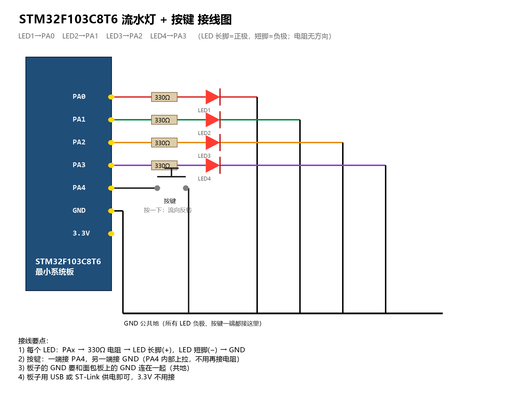
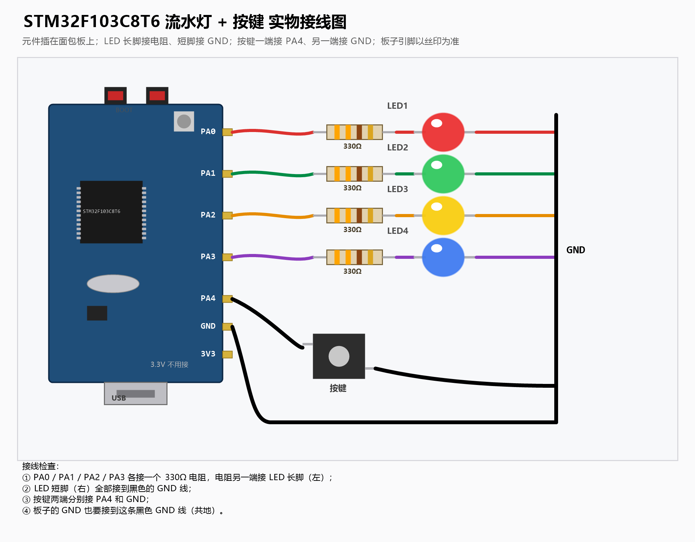

# 流水灯（STM32F103C8T6 + Keil MDK）

> 课程作业：面包板 4 个 LED 流水灯 + 按键换向

## 功能

- 4 个 LED 轮流点亮，形成“流水”效果；
- 按下按键，流动方向反转（进阶要求）；
- 使用 STM32 标准外设库（StdPeriph）编写，Keil MDK 5.36 + ARM Compiler 5 编译。

## 接线





| 信号 | STM32 引脚 | 接法 |
|---|---|---|
| LED1 | PA0 | PA0 → 330Ω 电阻 → LED 长脚(+)；LED 短脚(−) → GND |
| LED2 | PA1 | 同上 |
| LED3 | PA2 | 同上 |
| LED4 | PA3 | 同上 |
| 按键 | PA4 | PA4 → 按键一端；按键另一端 → GND（PA4 内部上拉，按下为低电平） |

> 注意：LED 长脚是正极，短线/缺口一侧是负极；电阻用 220Ω～1kΩ 都可以，推荐 330Ω。
> 按键不接电阻也可以，PA4 已配置内部上拉。

## 使用方法

1. 用 Keil 打开 `LED_Running.uvprojx`；
2. `Project → Build Target`（F7）编译；
3. 连接 ST-Link（3.3V/GND/SWDIO/SWCLK），`Download`（F8）下载；
4. 下载后若程序没自动运行，按一下板子复位键。

## 可调参数

在 `User/main.c` 中：

```c
#define LED_NUM     4       /* LED 数量 */
#define SPEED_MS    200     /* 流水速度（ms），越大越慢 */
```

想增加 LED，把引脚加进 `LED_ALL`，并修改 `LED_NUM` 即可。

## 目录结构

```
LED_Running/
├── Start/                 启动文件
├── Library/               标准外设库（GPIO/RCC）+ CMSIS
├── User/main.c            主程序
├── Objects/               编译输出（hex/axf）
└── LED_Running.uvprojx    Keil 工程
```

## 效果

上电后 4 个 LED 依次点亮、循环流动；按一下按键，流动方向改变。
